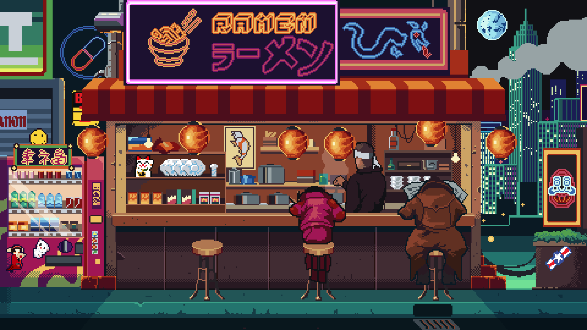

<table width="100%">
<tr>
<td align="left">
<strong>AI &amp; Full-Stack Developer.</strong> Building, automating, and shipping intelligent systems.
</td>
<td align="right">
<a href="https://github.com/DeepanB15">GitHub</a> ·
<a href="https://linkedin.com/in/deepanb">LinkedIn</a> ·
<a href="mailto:deepan.b.150706@gmail.com">Email</a>
</td>
</tr>
</table>I build AI-powered applications, agentic systems, open-source integrations, and full-stack products.
Open Source & Programs
- PipesHub AI · Open-source contributor · 2 merged PRs · MCP integrations
- Vercel MCP Integration · Remote MCP server catalog integration · OAuth 2.0, Dynamic Client Registration & Streamable HTTP · Merged Nov 2, 2026
- Zapier MCP Integration · Remote MCP server integration · OAuth 2.0/DCR, backend registration, frontend icon mapping & tests · Merged Nov 4, 2026
- Smart India Hackathon 2024 · Team Lead · Advanced to the national semifinals
- IEI Student Chapter · Vice President · Technical workshops, AI talks & student seminars
- StratIQ · AI Developer / Co-Founder · Lead intelligence, CRM workflows & AI automation
- Freelance · Full-Stack Developer · Building and delivering client web solutions
